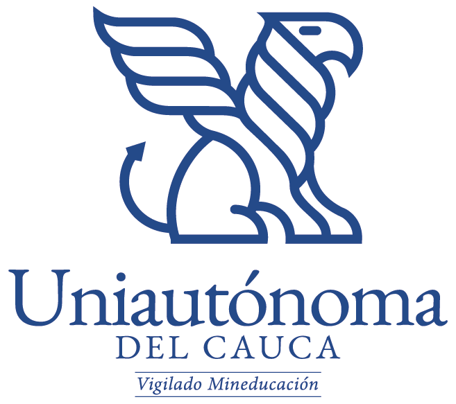

# Mesa y Sazón — Grupo 3

**Desarrollo de Aplicaciones Web · Parcial 2.º corte**  


# Mesa y Sazón — Grupo 3

**Corporación Universitaria Autónoma del Cauca**  
**Desarrollo de Aplicaciones Web · Parcial 2.º corte**  
**Integrantes:** Joan Alberto Erazo Zuñiga, Daniela Medina Pizarro y Juan Sebastian Florez.

Aplicación académica con Django REST Framework y una interfaz de HTML, CSS y JavaScript puro. Incluye tres recursos conectados: **Platos**, **Mesas** y **Pedidos**. Un pedido referencia una mesa y un plato mediante claves foráneas.

## Requisitos

- Python 3.10 o superior. La versión verificada de este proyecto es Django 5.2.18 y Django REST Framework 3.18.3.
- pip.

## Ejecutar en Windows

En PowerShell, desde la carpeta del proyecto:

```powershell
py -m venv .venv
.venv\Scripts\Activate.ps1
python -m pip install -r requirements.txt
python manage.py makemigrations platos mesas pedidos
python manage.py migrate
python manage.py check
python manage.py test
python manage.py runserver
```

Abre `http://127.0.0.1:8000/` para el panel y `http://127.0.0.1:8000/api/` para el API root.

Si PowerShell bloquea la activación del entorno, ejecuta `Set-ExecutionPolicy -Scope Process -ExecutionPolicy Bypass` en esa misma ventana y vuelve a activarlo. También puedes instalar dependencias con `python -m pip install -r requirements.txt` sin activar el entorno, aunque se recomienda usarlo.

## Ejecutar en macOS o Linux

```bash
python3 -m venv .venv
source .venv/bin/activate
python -m pip install -r requirements.txt
python manage.py makemigrations platos mesas pedidos
python manage.py migrate
python manage.py check
python manage.py test
python manage.py runserver
```

## API

| Método | Ruta | Acción |
|---|---|---|
| GET / POST | `/api/platos/` | Listar / crear platos |
| GET / PUT / PATCH / DELETE | `/api/platos/{id}/` | Consultar / editar / borrar plato |
| GET / POST | `/api/mesas/` | Listar / crear mesas |
| GET / PUT / PATCH / DELETE | `/api/mesas/{id}/` | Consultar / editar / borrar mesa |
| GET / POST | `/api/pedidos/` | Listar / crear pedidos |
| GET / PUT / PATCH / DELETE | `/api/pedidos/{id}/` | Consultar / editar / borrar pedido |

Los campos `mesa` y `plato` de un pedido reciben IDs. La respuesta además incluye `mesa_numero`, `plato_nombre` y `precio_unitario`. Se usa `PROTECT`: si se intenta eliminar una mesa o un plato referenciado, la API devuelve HTTP 409 con un mensaje legible.

## Uso recomendado para la demostración

1. Crea al menos dos platos.
2. Crea dos mesas con número y capacidad diferentes.
3. Registra un pedido escogiendo una mesa y un plato.
4. Cambia el estado del pedido a “En preparación” y después “Listo”.
5. Prueba editar y cancelar; prueba también borrar un plato usado por un pedido para ver la protección de la relación.

## Organización por integrante

La rúbrica pide que cada integrante suba su CRUD con commits propios. Carpeta sugerida: Joan trabaja `platos/`, Daniela `mesas/`, Juan `pedidos/`; acuerden otra asignación si prefieren y manténganla constante. Cada persona debe ejecutar los comandos desde su propia cuenta y usar su identidad Git configurada.

Flujo sugerido para cada integrante:

```bash
git switch main
git pull --rebase origin main
git switch -c feature/platos-joan  # cada integrante usa nombre/recurso propio
# editar y probar solo los archivos asignados
git add platos/
git commit -m "Implementa modelo y API de platos"
git pull --rebase origin main
git push -u origin feature/platos-joan
```

Luego integran mediante Pull Request o, si trabajan directamente en `main`, vuelven a hacer `git pull --rebase origin main` inmediatamente antes de su commit y push. No compartan contraseñas ni tokens. No usen mensajes como “cambios” o “listo”.

**Importante:** los commits y las pruebas deben ser reales, hechos por cada integrante. La asignación de carpetas anterior es sugerida, no sustituye el historial verificable del repositorio remoto.

## Archivos de apoyo

- `docs/bitacora_prompts.md`: bitácora editable con ocho etapas. Completen los resultados reales, capturas y enlace público de Google Drive antes de la entrega.
- `docs/guia_sustentacion.md`: respuestas sugeridas para las 11 preguntas del banco del profesor.
- `platos/tests.py`: pruebas de integración para API, relaciones y vista principal.

## Preguntas de sustentación

- **Serializer:** valida datos y convierte instancias/modelos a representaciones JSON y viceversa.
- **ViewSet:** agrupa las operaciones del recurso en una clase (listar, crear, consultar, actualizar, borrar) y evita repetir vistas.
- **DefaultRouter:** conecta los ViewSets y genera las rutas de colección y detalle; por ejemplo `/api/platos/` y `/api/platos/1/`.
- **Migraciones:** `makemigrations` traduce cambios de modelos a archivos versionados; `migrate` aplica esos cambios a la base de datos.
- **Relaciones:** `Pedido.mesa` y `Pedido.plato` son claves foráneas. La respuesta API entrega los IDs y campos legibles de la mesa y del plato.
- **Git:** `add` prepara archivos, `commit` guarda una versión local con autor y mensaje, `push` publica commits; `pull` trae cambios del remoto antes de integrar/subir para reducir conflictos; `log` muestra el historial.
- **IA:** expliquen el prompt concreto, revisen el código generado, prueben sus rutas y mencionen los ajustes. No digan que algo se probó si no lo ejecutaron.

## Lista final de entrega

- [x] Tres CRUD relacionados en un mismo proyecto; migraciones incluidas.
- [x] Interfaz sin frameworks con GET, POST, PUT y DELETE implementados.
- [x] README e instrucciones para ejecutar.
- [x] Cuatro pruebas automatizadas pasan; `manage.py check` no reporta errores; `node --check static/app.js` pasa.
- [ ] Cada integrante debe realizar commits propios desde su identidad Git.
- [ ] El grupo debe probar el flujo completo de formularios desde navegador y guardar evidencia.
- [ ] Subir `docs/bitacora_prompts.md` a Google Drive, registrar resultados reales y habilitar acceso “cualquier persona con el enlace puede ver”.
- [ ] Publicar el repositorio compartido y entregar sus dos enlaces en Moodle.
